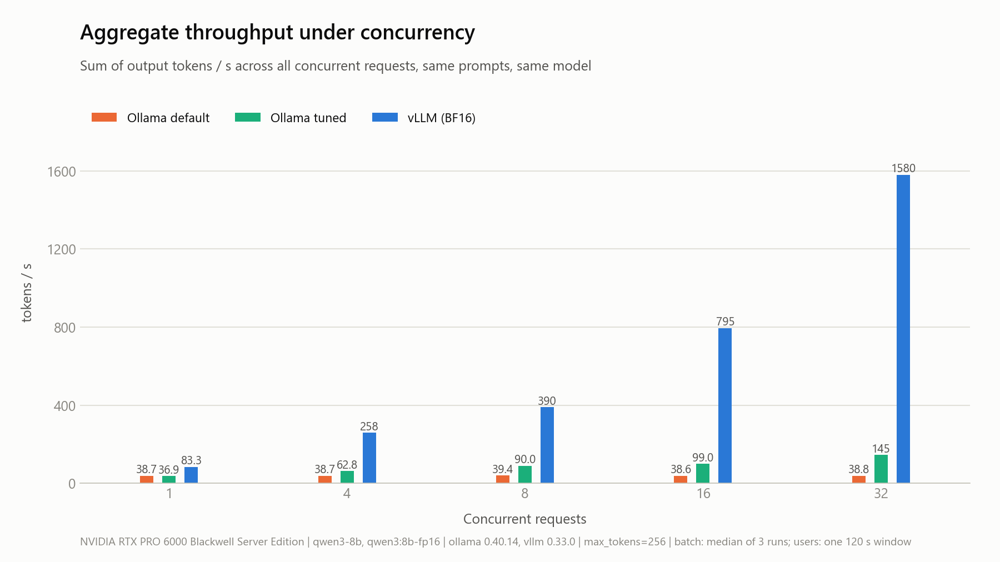
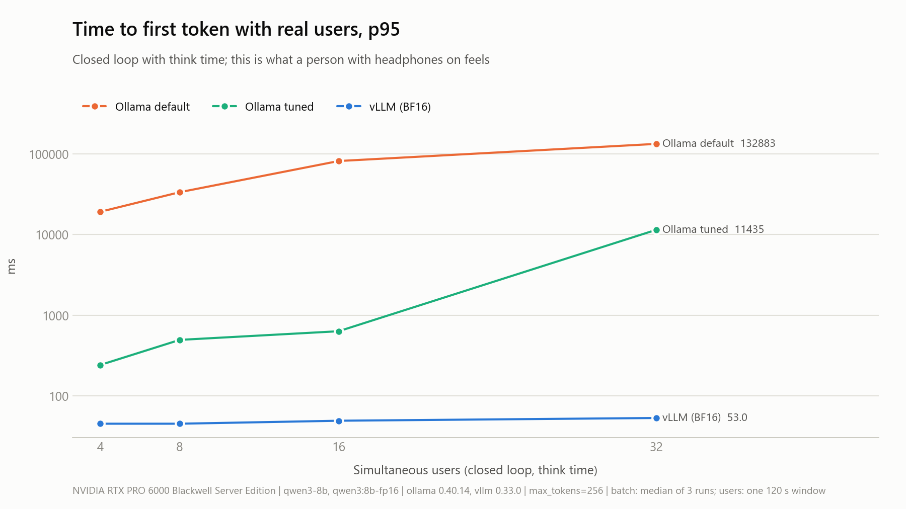

# Ollama vs vLLM: a real-traffic benchmark on one GPU

This repository compares Ollama and vLLM serving the same model on the same GPU, under realistic multi-user traffic. Everything needed to reproduce the run is included: scripts, configuration and raw data.

- **Model:** Qwen3-8B, 16-bit weights on both engines, thinking disabled on both.
- **GPU:** 1x NVIDIA RTX PRO 6000 Blackwell (96 GB).
- **Client:** one load generator talking to the same OpenAI-compatible streaming API on both engines, with the same seeded request sequence.
- **Traffic:** three shapes. A concurrency sweep, closed-loop virtual users who think between requests, and open-loop random arrivals that find the queueing cliff.

Full report: [docs/REPORT-2026-11-03.md](docs/REPORT-2026-11-03.md). Raw data: [results/](results/).

## Results at a glance

Ollama 0.40.14 and vLLM 0.33.0 on an RTX PRO 6000 Blackwell Server Edition, measured on 2026-11-03.

| What a user feels | Ollama default | Ollama tuned (16 slots) | vLLM BF16 |
|---|---|---|---|
| One user: decode speed | 42 tok/s | 42 tok/s | **89 tok/s** |
| One user: time to first token | 74 ms | 79 ms | **27 ms** |
| 32 simultaneous requests: TTFT p95 | 130 s | 15.6 s | **158 ms** |
| 32 simultaneous requests: aggregate | 39 tok/s | 145 tok/s | **1,580 tok/s** |
| 32 real users with think time: TTFT p95 | 133 s | 11.4 s | **53 ms** |
| 8 requests/s arriving at random: dropped | 396 of 458 | 110 of 460 | **0 of 487** |





The run also covered four vLLM-only experiments:

- **AWQ with the Marlin kernel:** 213 tok/s for one user and 3,306 tok/s at 32 concurrent requests, about 2.1x to 2.4x BF16.
- **Half the GPU** (`--gpu-memory-utilization 0.5`): no change in speed up to 32 users, and 48 GB left free for other workloads.
- **A 32k context limit** instead of 8k: the same KV memory, holding 14.2 full-length requests instead of 56.8.
- **A peak probe at 96 concurrent requests:** no errors and no preemptions.

The details are in the [report](docs/REPORT-2026-11-03.md).

## Repository layout

```
.
├── run-all.sh                  runs the whole matrix: core | extras | all | one <label> | report
├── config.env                  every setting: models, versions, levels, durations, paths
├── bench/
│   ├── loadgen.py              load generator (batch / users / rate), OpenAI-compatible streaming client
│   ├── sanity.py               per-engine check: thinking off, token counts, usage field in the stream
│   ├── analyze.py              summary.jsonl + gpu.csv + meta.json -> REPORT.md, tables, PNG charts
│   └── prompts.json            one fixed ~500-token prompt plus a short / medium / long pool
├── server/                     scripts for the GPU server (bash, Ubuntu)
│   ├── runpod-setup.sh         one-shot setup inside a RunPod pod (the tested path)
│   ├── preflight.sh            checks driver >= 570, vLLM runtime, Ollama, disk, Python dependencies
│   ├── start-ollama.sh         default | tuned
│   ├── start-vllm.sh           bf16 | awq-marlin | awq-plain | u050 | ctx32k   (native or Docker)
│   ├── stop-all.sh             stops every engine and waits until the VRAM is empty
│   ├── gpu-monitor.sh          1 Hz nvidia-smi sampler with epoch timestamps
│   └── capture-meta.sh         versions, driver, launch command, vLLM KV-cache log lines -> meta.json
├── docs/
│   ├── REPORT-2026-11-03.md    the full results report
│   ├── TEST-PLAN.md            what is fixed, what varies, why, and how long it takes
│   ├── RUNPOD.md               how the published run was set up on RunPod, step by step
│   ├── HARDWARE.md             what server, GPU and disk to prepare
│   ├── RUNBOOK.md              the original manual plan this repository automates
│   └── LINKEDIN-REPORT-TEMPLATE.md   post template with each blank mapped to a report cell
└── results/                    <label>/summary.jsonl, requests-*.jsonl, gpu.csv, meta.json; report/
```

## Reproducing the run

### On RunPod (the tested path)

Follow [docs/RUNPOD.md](docs/RUNPOD.md). In short, rent one RTX PRO 6000 pod, copy this repository to `/workspace`, and run:

```bash
cd /workspace/Ollama-vs-Vllm
chmod +x run-all.sh server/*.sh
bash server/runpod-setup.sh                          # venv, vLLM, kernels, Ollama, both model formats (~20 min)
setsid nohup ./run-all.sh all > logs/all.out 2>&1 < /dev/null &
tail -f logs/phase-status.txt                        # one line per finished step; ~2.5 h in total
```

### On your own Ubuntu server

You need an NVIDIA driver of 570 or newer for Blackwell. Install Ollama, then pick one of two ways to run vLLM:

- **Native:** set `VLLM_NATIVE=1` and install `vllm` into the Python environment that `PY` points to.
- **Docker:** install Docker with the NVIDIA Container Toolkit, keep `VLLM_NATIVE=0`, and pull `VLLM_IMAGE`. The Docker path is supported by the scripts but was not used for the published numbers.

```bash
python3 -m venv .venv && .venv/bin/pip install -r requirements.txt vllm==0.33.0
export PY=$PWD/.venv/bin/python
.venv/bin/vllm download-kernels                      # prebuilt FlashInfer kernels (needed on Blackwell without nvcc)
ollama pull qwen3:8b-fp16                            # ~16 GB; NOT the default 4-bit tag
nano config.env                                      # HF_HOME, VLLM_NATIVE=1, levels
chmod +x run-all.sh server/*.sh
./run-all.sh core                                    # ollama-default, ollama-tuned, vllm-bf16 (~1.5 h)
./run-all.sh extras                                  # AWQ x2, 50% VRAM, peak probe, 32k log (~1 h)
```

The output lands in three places:

- `results/report/REPORT.md` holds the tables.
- `results/report/charts/` holds 1800x1012 PNG charts in light and dark versions.
- `results/report/all-runs.csv` holds every run in one flat file.

### Running the client from a second machine

Start one engine on the GPU server, for example `server/start-vllm.sh bf16`. Then start the monitor with `server/gpu-monitor.sh start vllm-bf16` and record metadata with `server/capture-meta.sh vllm-bf16 vllm`. On the client (Python 3.11+):

```bash
pip install -r requirements.txt
python bench/sanity.py  --url http://GPU_IP:8000/v1/chat/completions --model qwen3-8b
python bench/loadgen.py --url http://GPU_IP:8000/v1/chat/completions --model qwen3-8b --label vllm-bf16 --mode batch --levels 1,4,8,16,32 --runs 3 --prompt-mix realistic
python bench/loadgen.py --url http://GPU_IP:8000/v1/chat/completions --model qwen3-8b --label vllm-bf16 --mode users --levels 4,8,16,32 --duration 120 --runs 1 --prompt-mix realistic
python bench/loadgen.py --url http://GPU_IP:8000/v1/chat/completions --model qwen3-8b --label vllm-bf16 --mode rate  --levels 0.5,1,2,4,8 --duration 60 --timeout 120 --runs 1 --prompt-mix realistic
```

Then run `server/gpu-monitor.sh stop && server/stop-all.sh` on the server, put the client's `results/vllm-bf16/` folder next to the server's `gpu.csv` and `meta.json`, and run `python bench/analyze.py`. Do not send benchmark traffic through an HTTPS proxy, because proxies can buffer streaming responses and distort TTFT.

## Fairness rules

1. Both engines use 16-bit weights. Ollama's default `qwen3:8b` tag is 4-bit, so use `qwen3:8b-fp16`.
2. Thinking is off on both. `sanity.py` fails if a `<think>` block or a reasoning field appears.
3. Both use an 8k context: `--max-model-len 8192` for vLLM and `OLLAMA_CONTEXT_LENGTH=8192` for Ollama tuned.
4. Only one engine is on the GPU at a time. `stop-all.sh` waits until less than 1 GB of VRAM is in use.
5. Engine versions are pinned in `config.env`, and `meta.json` records what actually ran.
6. Both engines get the same seed, the same prompt sequence and the same client code.
7. Sweeps report the median of 3 runs. p95 is reported everywhere, and errors are reported, not hidden.

## Known engine quirks

- **Ollama's OpenAI endpoint disables Qwen3 thinking only with `reasoning_effort: "none"`.** It ignores `think: false` and `/no_think` (verified on 0.40.14). The client sets the right switch for each engine automatically.
- **vLLM on Blackwell can crash at start-up** while JIT-compiling the FlashInfer sampling kernel when `nvcc` is not installed. Run `vllm download-kernels` once to install prebuilt kernels.
- **Ollama 0.40's default context is 40,960 tokens.** The default configuration also serves requests one at a time under load.
- **`OLLAMA_NUM_PARALLEL=16` with `OLLAMA_CONTEXT_LENGTH=8192` reserves KV cache for 16 x 8k tokens** at start-up. VRAM went from 21 GB to 33 GB on this card.
- **Older Ollama versions may omit `usage` in streamed responses.** The client then counts chunks instead, which is about one token each. `sanity.py` prints the deviation.

## License

[MIT](LICENSE).
