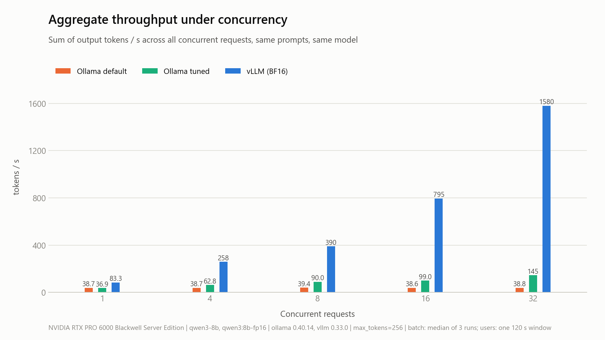
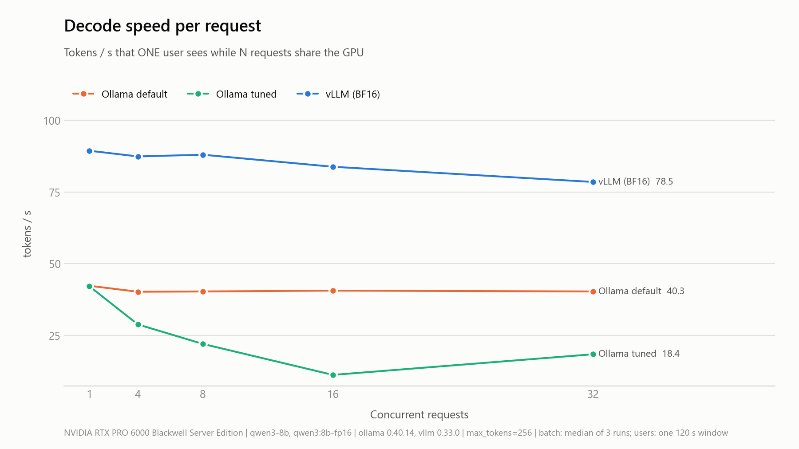
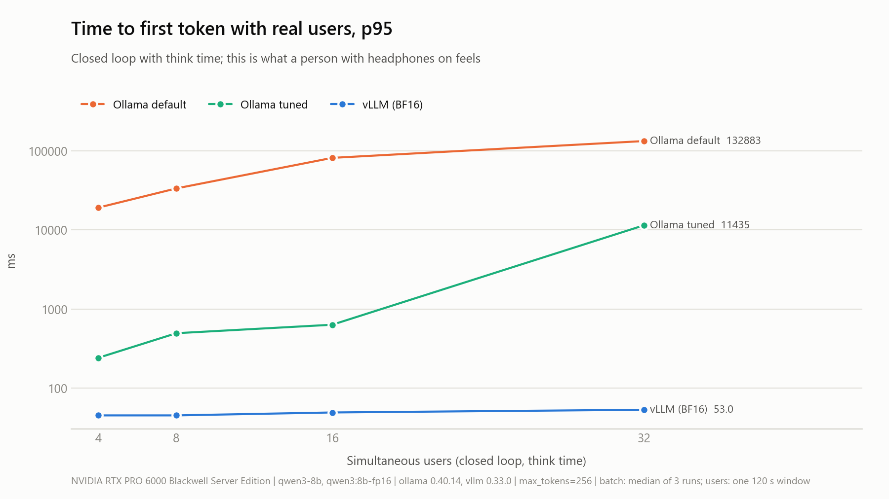
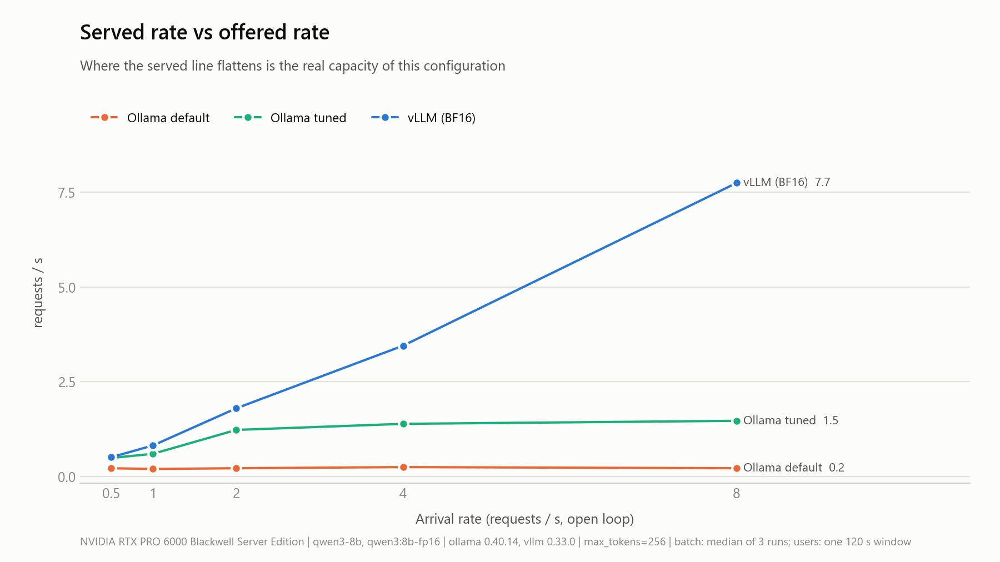
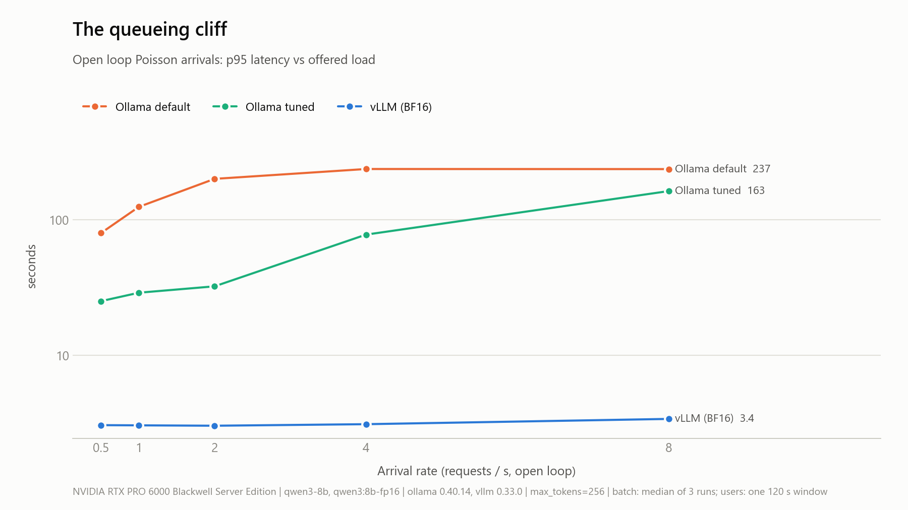
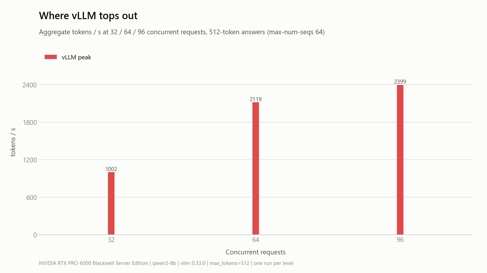

# Ollama vs vLLM on one RTX PRO 6000 Blackwell: real-traffic benchmark report

Run date: 2026-11-03, 09:28 to 11:58 UTC.

- Raw data is in [`results/`](../results/): per-request JSONL, per-run summaries, 1 Hz GPU samples, and one `meta.json` per configuration.
- Charts are in [`results/report/charts/`](../results/report/charts/), and the generated tables in [`results/report/REPORT.md`](../results/report/REPORT.md).
- Reproduce everything with `./run-all.sh all`. See [RUNPOD.md](RUNPOD.md) for the exact setup that produced these numbers.

---

## 1. Executive summary

Both engines ran on the same GPU with the same weights (Qwen3-8B, 16-bit) and the same client. Both received the same seeded sequence of prompts, with thinking disabled. Only one engine was on the card at a time.

| What a user feels | Ollama default | Ollama tuned (16 slots) | vLLM 0.33 BF16 |
|---|---|---|---|
| One user: decode speed | 42 tok/s | 42 tok/s | **89 tok/s** |
| One user: time to first token | 74 ms | 79 ms | **27 ms** |
| 32 simultaneous requests: TTFT p95 | 130 s | 15.6 s | **158 ms** |
| 32 simultaneous requests: per-user decode | 40 tok/s (one at a time) | 18 tok/s | **78 tok/s** |
| 32 simultaneous requests: aggregate | 39 tok/s | 145 tok/s | **1,580 tok/s** |
| 32 real users with think time: TTFT p95 | 133 s | 11.4 s | **53 ms** |
| 8 requests/s arriving at random: served, dropped | 0.22 req/s, 396 of 458 dropped | 1.47 req/s, 110 of 460 dropped | **7.74 req/s, 0 dropped** |
| VRAM, peak during runs | 21.0 GiB | 33.2 GiB | 80.8 GiB (85% reserved by design) |

**Headline.** On this card, vLLM is 2.1x faster for a single user. At 32 concurrent requests its aggregate throughput is 41x Ollama default and 11x Ollama tuned, and the first token still arrives in under 160 ms.

Ollama's default configuration processes requests one at a time. Tuning it to 16 parallel slots buys concurrency, but at 16 to 32 concurrent requests each user's speed drops to 11 to 18 tok/s.

**The follow-up questions, answered with numbers:**

- **AWQ vs BF16 on Blackwell.** AWQ with the Marlin kernel reaches 213 tok/s for one user, 2.4x BF16. At 32 concurrent requests it reaches 3,306 tok/s aggregate, 2.1x BF16, with a 139 ms TTFT p95. vLLM 0.33 selects `MarlinLinearKernel` even when `--quantization awq` is forced, so "plain AWQ" is no longer a separate code path.
- **Sharing the card with `--gpu-memory-utilization 0.5`.** Latency and throughput stay within 8% of the 0.85 setting up to 32 concurrent requests. The real cost is KV-cache capacity: 227k tokens (27.7 concurrent 8k requests) instead of 469k tokens (57.2). About 48 GiB stays free for Whisper, TTS or evaluation jobs.
- **max-model-len decides how the KV cache is split.** The KV memory is about 64 GiB at both 8k and 32k context. At 32k it holds 14.2 full-length requests instead of 57.2.
- **Where it breaks.** At 96 concurrent 512-token requests, with `--max-num-seqs 64`, vLLM still served every request: 2,399 tok/s with a 7.1 s p95 latency. TTFT p95 jumped from 188 ms at 64 requests to 901 ms at 96. None of the 11,106 requests sent to vLLM across all configurations failed, and the peak probe recorded no preemptions.

---

## 2. Environment and disclosure

| Item | Value |
|---|---|
| Host | RunPod Secure Cloud, datacenter EUR-IS-2 |
| GPU | 1x NVIDIA RTX PRO 6000 Blackwell **Server Edition**, 96 GB (97,887 MiB), 600 W power limit, compute capability 12.0 |
| Driver and CUDA | driver 595.91.07, host CUDA 13.2 |
| CPU and RAM | 32 vCPU and 125 GB RAM allocated to the pod, per the RunPod pod listing; the host has a 64-core AMD EPYC 9554 and 1 TB RAM |
| OS | Ubuntu 24.04.5 LTS, image `runpod/pytorch:1.5.0-cu1281-torch280-ubuntu2404` |
| Ollama | 0.40.14, model `qwen3:8b-fp16` (GGUF F16, 16.4 GB), llama.cpp runner |
| vLLM | 0.33.0 installed with pip and run as a native process; torch 2.14.0+cu130; FlashInfer 0.7.2 with prebuilt sm120 kernels from `vllm download-kernels`; attention backend FLASH_ATTN |
| Models | `Qwen/Qwen3-8B` BF16 safetensors (15.27 GiB loaded) and `Qwen/Qwen3-8B-AWQ` (5.71 GiB loaded) |
| Thinking | Disabled on both engines and checked on every run. Ollama's OpenAI endpoint needs `reasoning_effort: "none"`. vLLM needs `chat_template_kwargs.enable_thinking=false`. For the fixed prompt, the first 120 characters of output were identical on both engines. |
| Client | [`bench/loadgen.py`](../bench/loadgen.py), streaming OpenAI-compatible `/v1/chat/completions` on both engines, `temperature 0`, `max_tokens 256` (512 for the peak probe). A fixed seed gives both engines the same request sequence. The client ran on the pod against localhost, with no proxy in the path, and keeps at most 64 connections open at a time. |
| Prompts | Realistic mix drawn per request with a fixed seed. Measured over all 13,767 requests: 39.5% short (60 to 71 tokens), 43.4% medium (286 to 391 tokens), 17.1% long (756 to 1,021 tokens). The single fixed prompt used by `sanity.py` tokenizes to 520 tokens on vLLM and 524 on Ollama. |
| Context | vLLM `--max-model-len 8192`. Ollama tuned `OLLAMA_CONTEXT_LENGTH=8192`. Ollama default keeps its own default of 40,960. |
| Repeats | Batch: 3 runs per level, median reported. Users: one 120 s window per level. Rate: one 60 s window of arrivals per level; the drop rule is described in section 3.3. |
| Thermals | Maximum GPU temperature 53 °C. The SM clock never fell below 2,280 MHz (maximum 2,430 MHz), so there was no throttling. |

### Configurations

| Label | Engine | Settings |
|---|---|---|
| `ollama-default` | Ollama | Fresh-install defaults, plus `OLLAMA_KEEP_ALIVE=-1` so model loading is never measured. Context 40,960. It behaves as a single parallel slot: aggregate throughput never exceeds one request's speed. |
| `ollama-tuned` | Ollama | `OLLAMA_NUM_PARALLEL=16 OLLAMA_CONTEXT_LENGTH=8192 OLLAMA_FLASH_ATTENTION=1 OLLAMA_KV_CACHE_TYPE=f16` |
| `vllm-bf16` | vLLM | `--dtype bfloat16 --max-model-len 8192 --gpu-memory-utilization 0.85 --max-num-seqs 64` |
| `vllm-awq-marlin` | vLLM | `Qwen/Qwen3-8B-AWQ`, kernel chosen automatically (Marlin) |
| `vllm-awq-plain` | vLLM | `Qwen/Qwen3-8B-AWQ --quantization awq`; vLLM 0.33 still uses Marlin, see section 4.1 |
| `vllm-bf16-u050` | vLLM | Same as `vllm-bf16` with `--gpu-memory-utilization 0.5` |
| `vllm-peak` | vLLM | Same as `vllm-bf16`; 32, 64 and 96 concurrent requests with 512-token answers; `/metrics` scraped every 2 s |
| `vllm-ctx32k` | vLLM | Start-up only, `--max-model-len 32768`, to read the KV-cache budget |

---

## 3. Core results

### 3.1 Concurrency sweep

N requests are sent at the same moment. Each value is the median of 3 runs.

| config | concurrent | TTFT median | TTFT p95 | per-request tok/s | aggregate tok/s | latency median | latency p95 |
|---|---|---|---|---|---|---|---|
| Ollama default | 1 | 74 ms | 74 ms | 42.3 | 38.7 | 0.88 s | 0.88 s |
| Ollama default | 4 | 4.3 s | 14.0 s | 40.2 | 38.7 | 10.7 s | 20.4 s |
| Ollama default | 8 | 8.7 s | 23.5 s | 40.3 | 39.4 | 12.3 s | 29.9 s |
| Ollama default | 16 | 24.1 s | 58.7 s | 40.6 | 38.6 | 27.6 s | 65.0 s |
| Ollama default | 32 | 60.3 s | 129.5 s | 40.3 | 38.8 | 64.2 s | 135.9 s |
| Ollama tuned | 1 | 79 ms | 79 ms | 42.2 | 36.9 | 0.92 s | 0.92 s |
| Ollama tuned | 4 | 320 ms | 320 ms | 28.8 | 62.8 | 9.2 s | 9.2 s |
| Ollama tuned | 8 | 441 ms | 444 ms | 22.0 | 90.0 | 12.1 s | 15.5 s |
| Ollama tuned | 16 | 837 ms | 839 ms | 11.2 | 99.0 | 23.1 s | 23.5 s |
| Ollama tuned | 32 | 1.44 s | 15.6 s | 18.4 | 144.8 | 14.6 s | 36.6 s |
| vLLM BF16 | 1 | 27 ms | 27 ms | 89.4 | 83.3 | 0.36 s | 0.36 s |
| vLLM BF16 | 4 | 61 ms | 62 ms | 87.4 | 258.5 | 2.99 s | 3.00 s |
| vLLM BF16 | 8 | 73 ms | 73 ms | 88.0 | 390.2 | 1.78 s | 2.99 s |
| vLLM BF16 | 16 | 104 ms | 104 ms | 83.8 | 795.2 | 3.16 s | 3.16 s |
| vLLM BF16 | 32 | 148 ms | 158 ms | 78.5 | 1,580.0 | 3.39 s | 3.43 s |



How to read it:

- **Ollama default never exceeds 39 tok/s in aggregate**, at any concurrency. It serves one request at a time and queues the rest, so TTFT grows linearly with the number of users. With 32 users, the last person waits more than two minutes for the first word.
- **Ollama tuned batches up to 16 sequences** in llama.cpp. Median TTFT improves 13x to 42x and aggregate throughput rises up to 3.7x. Per-request decode falls to 11 to 18 tok/s, because every user shares a runner that does not scale with batch size.
- **vLLM keeps per-request decode between 78 and 89 tok/s** all the way to 32 concurrent requests, thanks to continuous batching. TTFT stays under 160 ms and aggregate throughput grows almost linearly, from 83 to 1,580 tok/s.
- **vLLM's ~3 s latency from 4 requests upward is answer length, not queueing.** The prompt mix produces answers of up to 256 tokens, and 256 tokens at about 85 tok/s take 3 s.



### 3.2 Virtual users

Each virtual user sends a request, reads the full answer, thinks for about 3 s, then sends the next one. Each level ran for 120 s.

| config | users | served req/s | aggregate tok/s | TTFT median | TTFT p95 | latency p95 | requests completed |
|---|---|---|---|---|---|---|---|
| Ollama default | 4 | 0.22 | 38 | 9.6 s | 19.1 s | 24.7 s | 29 |
| Ollama default | 8 | 0.27 | 39 | 20.9 s | 33.5 s | 39.0 s | 42 |
| Ollama default | 16 | 0.20 | 37 | 63.3 s | 81.4 s | 87.4 s | 41 |
| Ollama default | 32 | 0.23 | 39 | 119.7 s | 132.9 s | 138.0 s | 58 |
| Ollama tuned | 4 | 0.24 | 43 | 179 ms | 241 ms | 21.3 s | 31 |
| Ollama tuned | 8 | 0.33 | 48 | 292 ms | 493 ms | 40.6 s | 48 |
| Ollama tuned | 16 | 0.73 | 127 | 292 ms | 631 ms | 27.8 s | 112 |
| Ollama tuned | 32 | 1.29 | 223 | 7.4 s | 11.4 s | 26.3 s | 208 |
| vLLM BF16 | 4 | 0.79 | 137 | 37 ms | 45 ms | 3.03 s | 101 |
| vLLM BF16 | 8 | 1.50 | 235 | 37 ms | 45 ms | 3.00 s | 207 |
| vLLM BF16 | 16 | 2.86 | 496 | 39 ms | 49 ms | 3.05 s | 380 |
| vLLM BF16 | 32 | 5.27 | 877 | 42 ms | 53 ms | 3.22 s | 749 |

With 32 people talking for two minutes, vLLM completed 749 requests, Ollama tuned 208 and Ollama default 58. The 95th-percentile person waited 53 ms for the first word with vLLM. With Ollama tuned they waited 11.4 s, and with Ollama default 2 minutes 13 seconds.



### 3.3 Open loop

Requests arrive at random (Poisson) at a fixed rate for 60 s. Arrivals do not slow down when the server does.

The client keeps at most 64 connections open. A request is dropped if it waits more than 120 s for a free connection, or if it receives no data for 120 s after being sent. TTFT and latency are measured from the moment the request is created, so they include any time spent waiting for a connection, as a user would experience it. That is why some values exceed 120 s.

| config | offered req/s | served req/s | aggregate tok/s | TTFT p95 | latency p95 | dropped of total |
|---|---|---|---|---|---|---|
| Ollama default | 0.5 | 0.22 | 39 | 73.6 s | 79.9 s | 0 of 31 |
| Ollama default | 1 | 0.20 | 39 | 119.5 s | 124.7 s | 13 of 50 |
| Ollama default | 2 | 0.22 | 39 | 196.9 s | 200.7 s | 54 of 111 |
| Ollama default | 4 | 0.25 | 39 | 231.1 s | 237.4 s | 137 of 211 |
| Ollama default | 8 | 0.22 | 40 | 231.2 s | 237.0 s | 396 of 458 |
| Ollama tuned | 0.5 | 0.49 | 87 | 555 ms | 25.1 s | 0 of 31 |
| Ollama tuned | 1 | 0.60 | 108 | 495 ms | 28.9 s | 0 of 50 |
| Ollama tuned | 2 | 1.23 | 217 | 14.0 s | 32.3 s | 0 of 112 |
| Ollama tuned | 4 | 1.39 | 233 | 65.2 s | 77.7 s | 0 of 212 |
| Ollama tuned | 8 | 1.47 | 245 | 150.5 s | 163.1 s | 110 of 460 |
| vLLM BF16 | 0.5 | 0.51 | 90 | 44 ms | 3.04 s | 0 of 31 |
| vLLM BF16 | 1 | 0.82 | 147 | 45 ms | 3.03 s | 0 of 50 |
| vLLM BF16 | 2 | 1.80 | 319 | 46 ms | 3.01 s | 0 of 115 |
| vLLM BF16 | 4 | 3.45 | 575 | 51 ms | 3.09 s | 0 of 215 |
| vLLM BF16 | 8 | 7.74 | 1,287 | 59 ms | 3.38 s | 0 of 487 |

Real capacity is where the "served" column stops rising:

| config | capacity |
|---|---|
| Ollama default | about 0.22 req/s |
| Ollama tuned | about 1.5 req/s |
| vLLM BF16 | above 7.7 req/s, still rising at 8 |

At 8 req/s, Ollama default dropped 86% of requests and Ollama tuned 24%. vLLM dropped none.

Most of these drops happened at the client. 316 of Ollama default's 396 drops, and all 110 of Ollama tuned's, were requests that waited more than 120 s for a free connection, because all 64 were held by requests the engine had not finished. A higher connection limit would move that queue into the engine; it would not raise the served rate, which the engine sets.





---

## 4. Additional experiments

### 4.1 AWQ (4-bit) vs BF16 on vLLM

| config | 1 user: tok/s | 1 user: TTFT | 32 concurrent: per-request tok/s | 32 concurrent: aggregate | 32 concurrent: TTFT p95 | 32 users: TTFT p95 | served at 8 req/s |
|---|---|---|---|---|---|---|---|
| vLLM BF16 | 89.4 | 27 ms | 78.5 | 1,580 | 158 ms | 53 ms | 7.74 |
| vLLM AWQ, kernel chosen automatically (Marlin) | 212.8 | 26 ms | 167.9 | 3,306 | 139 ms | 40 ms | 7.99 |
| vLLM AWQ, `--quantization awq` forced | 212.2 | 27 ms | 167.8 | 3,302 | 144 ms | 39 ms | 7.97 |

Start-up log lines from the two AWQ runs and the BF16 run:

```
Using MarlinLinearKernel for AutoAWQMarlinLinearMethod        (both AWQ runs)
Model loading took 5.71 GiB                                   (AWQ)
Model loading took 15.27 GiB                                  (BF16)
GPU KV cache size: 534,768 tokens, Maximum concurrency for 8,192 tokens per request: 65.28x   (AWQ, kernel automatic)
GPU KV cache size: 538,672 tokens, Maximum concurrency for 8,192 tokens per request: 65.76x   (AWQ, --quantization awq)
GPU KV cache size: 468,912 tokens, Maximum concurrency for 8,192 tokens per request: 57.24x   (BF16)
```

Decoding an 8B model is limited by memory bandwidth, so reading 4-bit weights instead of 16-bit weights is what matters. The Marlin kernel turns the smaller weights into 2.4x the single-user speed.

vLLM 0.33 upgrades `awq` to `awq_marlin` automatically. The plain AWQ kernel of older versions therefore cannot be selected this way, and the two AWQ rows run the same code. Output quality was not evaluated; these are speed results only.

### 4.2 Sharing the GPU with `--gpu-memory-utilization 0.5`

| | 0.85 | 0.5 |
|---|---|---|
| VRAM, peak during runs | 80.8 GiB | 47.6 GiB |
| Available KV cache memory | 64.4 GiB | 31.16 GiB |
| GPU KV cache size | 468,912 tokens | 226,864 tokens |
| Maximum concurrency for 8,192-token requests | 57.24x | 27.69x |
| 32 concurrent: per-request tok/s, aggregate tok/s, TTFT p95 | 78.5, 1,580, 158 ms | 78.2, 1,573, 170 ms |
| 32 users: TTFT p95, latency p95 | 53 ms, 3.22 s | 55 ms, 3.22 s |
| 8 req/s: served, latency p95 | 7.74, 3.38 s | 7.74, 3.38 s |

Up to 32 concurrent users every result stays within 8% of the 0.85 setting, because the KV cache at 0.5 still holds 27 full 8k conversations. About 48 GiB is left for Whisper, TTS and evaluation jobs. The cost would only appear once the concurrent context exceeds about 227k tokens.

This experiment measured vLLM alone at 0.5. A second workload running on the freed half of the card at the same time was not measured.

### 4.3 max-model-len and the KV cache

| `--max-model-len` | available KV memory | GPU KV cache size | maximum concurrency at full length |
|---|---|---|---|
| 8,192 | 64.4 GiB | 468,912 tokens | 57.24x |
| 32,768 | 63.86 GiB | 465,024 tokens | 14.19x |

The memory and the token budget are nearly the same; the small difference comes from two separate start-ups measuring free memory. A longer allowed context only divides the budget into fewer full-length slots, so set it to the length you actually serve.

### 4.4 Peak: where vLLM tops out

Answers of up to 512 tokens, with `--max-num-seqs 64`; one run per level.

| concurrent | TTFT median | TTFT p95 | per-request tok/s | aggregate tok/s | latency p95 | errors |
|---|---|---|---|---|---|---|
| 32 | 149 ms | 156 ms | 79.1 | 1,003 | 4.3 s | 0 |
| 64 | 174 ms | 188 ms | 71.7 | 2,119 | 6.9 s | 0 |
| 96 | 227 ms | 901 ms | 70.2 | 2,399 | 7.1 s | 0 |

`/metrics` was scraped every 2 s during this probe only. It recorded a maximum `num_requests_running` of 51 and a `num_preemptions_total` of 0.

The jump in TTFT p95 at 96 requests is most likely the 64-sequence scheduler limit: requests beyond 64 wait for a free slot. The 2 s samples did not capture that queue, so this is an inference rather than a measurement. The KV budget allows a higher `--max-num-seqs` (57.2 full 8k requests, and far more for short ones), which is the setting to raise first.



---

## 5. Observations and caveats

1. **Ollama's single-user speed on this card is low.** Every decoded token reads the full 16.4 GB of weights. At 42 tok/s that is about 690 GB/s, roughly 38% of the card's 1.8 TB/s bandwidth. vLLM at 89 tok/s reaches about 1.46 TB/s, roughly 81%. The llama.cpp F16 path in Ollama 0.40 does not saturate Blackwell. This deserves a follow-up with Q8 and Q4 GGUF files and newer runner builds.
2. **Ollama 0.40's default context is 40,960 tokens.** "Default" therefore also means a 21.0 GiB footprint. The tuned run matches vLLM's 8k context and reserves 16 slots, for 33.2 GiB.
3. **F16 GGUF and BF16 safetensors are both 16-bit, but not bit-identical formats.** In the sanity check, the first 120 characters of output for the fixed prompt were identical, so the comparison is fair in practice. A perplexity comparison was not done.
4. **The client ran on the same pod as the server.** This avoids the RunPod HTTPS proxy, which buffers streaming responses. At 32 streams the client and the server share CPU; vLLM's TTFT stayed flat, so the effect is small.
5. **Users and rate results are single windows.** Batch values are medians of 3 runs. The closed-loop and open-loop results come from one 120 s or 60 s window per level. The differences between engines range from about 3x to 2,500x, so the conclusions hold, but second-decimal values will vary between runs.
6. **"Dropped" is defined by the client.** A request is abandoned after 120 s without a free client connection (the client keeps at most 64 open) or 120 s without data from the server, as a person would give up. Neither engine returned errors.
7. **vLLM on Blackwell needed one fix.** FlashInfer compiles its sampling kernel at first use, and the pod had no `nvcc` on its PATH, so the engine crashed at start-up. Running `vllm download-kernels` installs prebuilt sm120 kernels and solves it.
8. **Disabling thinking on Ollama's OpenAI endpoint only works with `reasoning_effort: "none"`.** That endpoint ignores `think: false` and the `/no_think` prompt switch. Without the fix, the output is reasoning instead of an answer: in the sanity check all 64 output tokens were reasoning and the visible answer was empty.

## 6. Cost and time

| Item | Value |
|---|---|
| Pod price | 2.53 USD/h |
| Setup and downloads, including finding the two fixes now built into `runpod-setup.sh` | about 45 min |
| Benchmark (all 8 configurations) | 2 h 30 min |
| Total pod time | about 3.5 h, under 10 USD |
